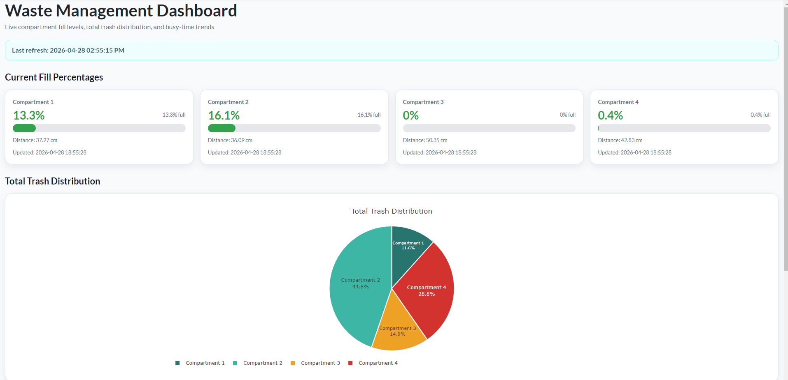
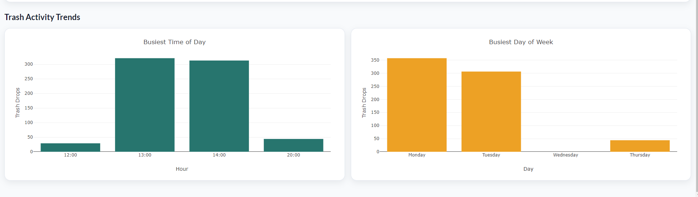
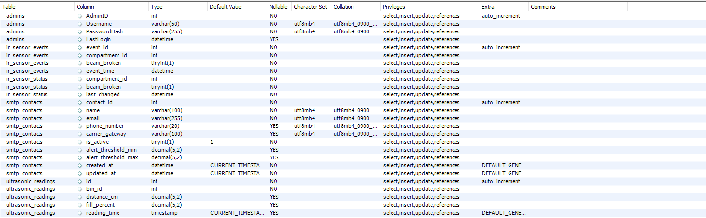

# IoT Multi-Compartment Smart Waste Management System

An automated, multi-compartment smart waste monitoring and analytics system built with a Raspberry Pi, hardware sensors, MySQL database, automated SMTP alert pipeline, and an interactive R Shiny real-time dashboard.

---

## Overview

Traditional waste bins often overflow before collection or get emptied while nearly empty. This system automates capacity tracking, usage-pattern detection, visual status indicators, and dispatch alerts for a 4-compartment waste receptacle (Trash, Paper/Aluminum, Compost, Glass/Plastic).

### Key Features
- **Ultrasonic Fill-Level Sensing:** Periodically measures distance in each bin compartment and calculates real-time fullness percentages.
- **IR Beam-Break Event Tracking:** Captures drop/usage events and logs timestamped interactions per compartment.
- **Visual Status Feedback:** Addressable WS2812B LED rings dynamically update color indicators (Green: `< 50%`, Yellow: `50%–84%`, Red: `≥ 85%`).
- **Automated Dispatch Alerts:** Background monitor triggers email and SMS-gateway alerts to facility managers when bins reach critical capacity.
- **Interactive Web Dashboard:** Real-time R Shiny interface visualizing current fill levels, total trash distribution, and peak usage hours/days.

---

## System Architecture & Workflow

```text
Hardware Layer:
  • Ultrasonic Sensors  ──►  Calculate Fill %  ──►  WS2812B LEDs (Status Colors)
  • IR Break Sensors    ──►  Detect Drop Events

Database Layer:
  • Sensor Data         ──►  MySQL Database (waste_management)

Application Layer:
  • MySQL Database      ──►  SMTP Alert Daemon  ──►  SMS & Email Alerts
  • MySQL Database      ──►  R Shiny Dashboard  ──►  Live Fill Levels & Charts
```

---

## Hardware Components

- **Controller:** Raspberry Pi (Raspberry Pi OS)
- **Depth Sensors:** 4x HC-SR04 Ultrasonic Distance Sensors
- **Drop Detection:** 4x Infrared (IR) Break-Beam Sensors via MCP3008 ADC (SPI Interface)
- **Status Indicators:** WS2812B Addressable RGB LED Strip / Rings (144 LEDs total)
- **Structure:** Custom 4-compartment enclosure with sensor mounting lid

---

## Repository Structure

```text
smart-waste-management-system/
├── .env.example              # Template for database & SMTP credentials
├── .gitignore                # Files excluded from version control
├── LICENSE                   # MIT open-source license
├── README.md                 # Project documentation and setup guide
├── requirements.txt          # Python dependencies
│
├── Documentations/
│   ├── raspberry_pi_setup.md # Hardware pinouts and OS setup guide
│   └── user_manual.md        # Operations, maintenance, and role guide
│
├── dashboard/
│   ├── apache_setup.md       # Apache reverse-proxy instructions
│   ├── data.R                # Interactive R Shiny telemetry dashboard
│   ├── WasteManagementDashboard1.png
│   └── WasteManagementDashboard2.png
│
├── database/
│   ├── Database.png
│   ├── Database2.png
│   ├── Database3.png
│   ├── sample_queries.sql    # Analytical and diagnostic SQL queries
│   └── schema.sql            # Table definitions for readings, IR events, contacts, admins
│
└── hardware/
    ├── config.py             # Hardware pinouts & baseline sensor configurations
    ├── ir_sensor.py          # MCP3008 ADC SPI loop for beam break detection
    ├── sensor_led.py         # Ultrasonic distance loop & LED controller
    └── SMTP.py               # Automated email & SMS threshold notification daemon
```

---

## Database Schema

The system relies on a centralized MySQL schema (`waste_management`):

- `ultrasonic_readings`: Stores `bin_id`, `distance_cm`, `fill_percent`, and `reading_time`.
- `ir_sensor_events`: Logs `compartment_id`, `beam_broken` flags, and `event_time`.
- `smtp_contacts`: Stores notification recipient emails, carrier gateways, and alert thresholds.
- `admins`: Stores administrator credentials and hashed passwords.

---

## Setup & Installation

### 1. Prerequisites
- Python 3.9+ with `pip`
- R 4.0+ with `shiny`, `bslib`, `DBI`, `RMariaDB`, `dplyr`, and `plotly`
- MySQL Server 8.0+

### 2. Environment Configuration
Copy the sample environment file and configure your credentials:

```bash
cp .env.example .env
```

Set your values in `.env`:
```ini
DB_HOST=127.0.0.1
DB_PORT=3306
DB_NAME=waste_management
DB_USER=your_db_user
DB_PASSWORD=your_db_password

SMTP_HOST=smtp.gmail.com
SMTP_PORT=587
SMTP_USER=your_email@gmail.com
SMTP_PASSWORD=your_gmail_app_password
```

### 3. Running Hardware Daemons
```bash
# Start ultrasonic and LED monitoring
python hardware/sensor_led.py &

# Start IR beam drop detection
python hardware/ir_sensor.py &

# Start notification service
python hardware/SMTP.py &
```

### 4. Running the Dashboard
```bash
Rscript -e "shiny::runApp('dashboard/data.R', port=3838, host='0.0.0.0')"
```

---

## Dashboard Analytics & Live Telemetry

The interactive R Shiny web interface displays live compartment fill levels, total trash distribution, and peak disposal activity trends over time:





---

## Database Architecture & Volume

The MySQL backend handles continuous high-frequency telemetry from the Raspberry Pi sensor daemons:



---

## License

This project is licensed under the MIT License - see the `LICENSE` file for details.
